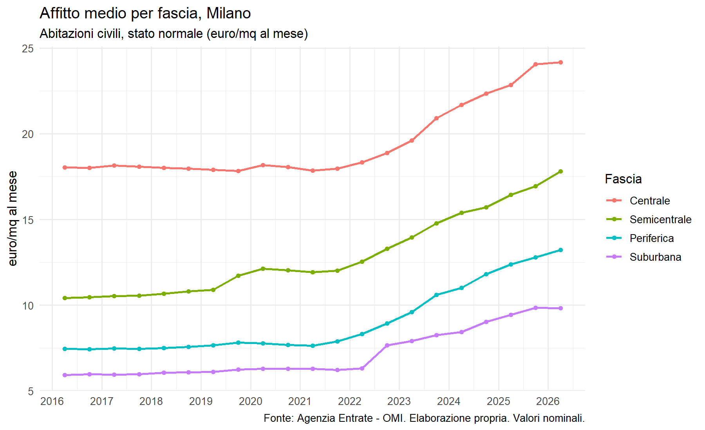
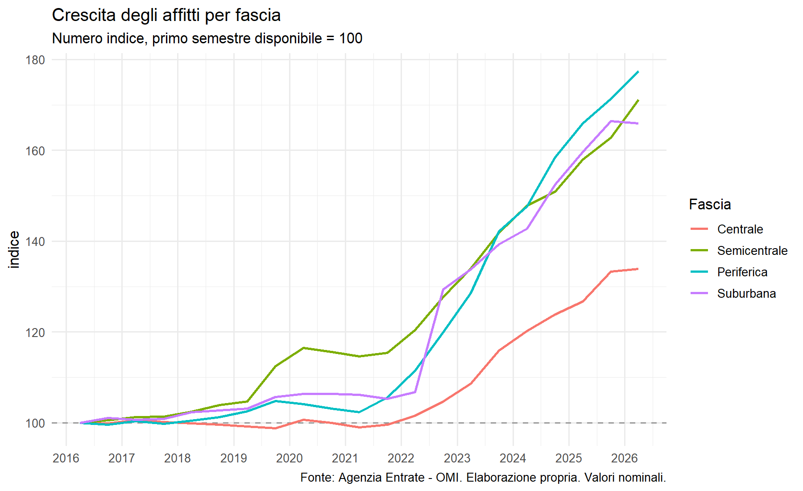
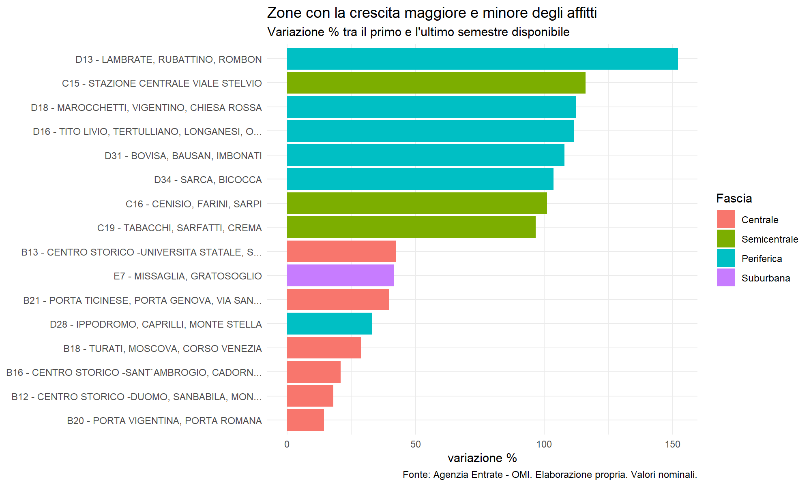
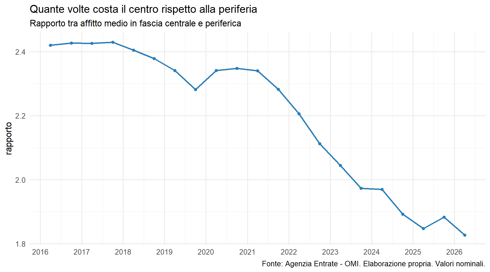
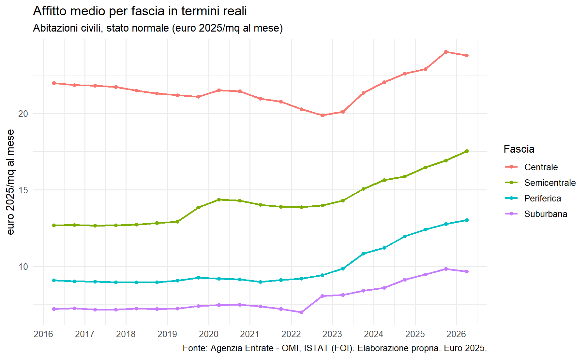
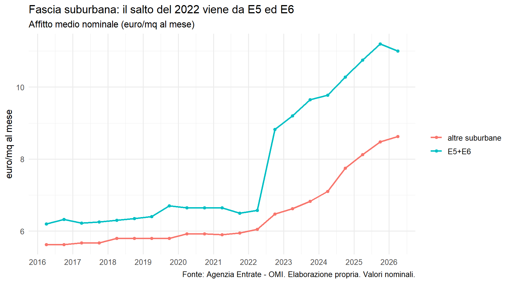
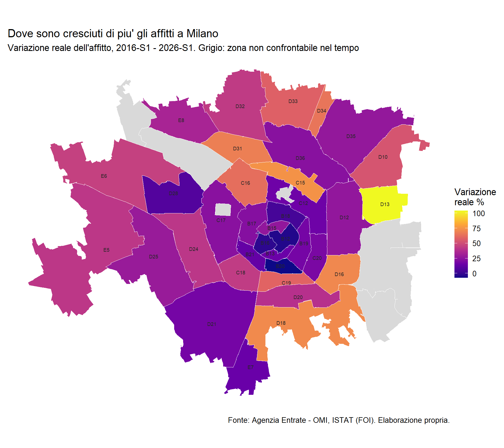
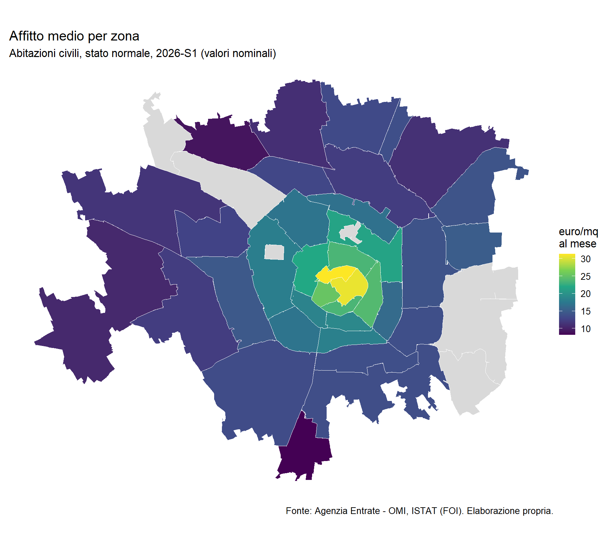

# Affitti a Milano 2016-2026: dove sono cresciuti di più?

Analisi dell'andamento dei canoni di locazione a Milano, per zona e per fascia urbana, sulle quotazioni semestrali dell'Osservatorio del Mercato Immobiliare (OMI) dell'Agenzia delle Entrate. Il progetto è scritto in R.

## Domanda

Tra il primo semestre 2016 e il primo semestre 2026, in quali zone di Milano gli affitti sono cresciuti di più, e il divario tra centro e periferia si è allargato o ridotto?

## Risposta in breve

- **Il divario tra centro e periferia si è ridotto.** Nel 2016 un metro quadro in fascia centrale costava circa 2,4 volte uno in fascia periferica, oggi circa 1,8 volte.
- **Il centro è cresciuto di meno.** Affitti nominali: centro +34%, semicentro +71%, periferia +77%, fascia suburbana +66%.
- **Il centro è stato fermo fino al 2021**, intorno a 18 €/mq al mese, poi è salito a circa 24 €/mq. Semicentro e periferia crescono già dal 2019-2020.
- **Le zone con la crescita maggiore** sono semicentrali e periferiche: in testa Lambrate-Rubattino-Rombon (+152% nominale, +104% reale), poi Stazione Centrale-viale Stelvio (+75% reale), Marocchetti-Vigentino e Tito Livio (+71-72%). **Tre zone della fascia centrale hanno perso valore in termini reali** (Porta Vigentina-Porta Romana, Duomo-Montenapoleone, Sant'Ambrogio-Cadorna, tra -2% e -8%). Brera è l'eccezione nel centro: +26% reale.
- **Sulla mappa si vede una struttura ad anelli.** I canoni più alti sono nel centro storico (oltre 30 €/mq), ma le crescite più forti si concentrano a nord (da Bovisa a Bicocca, passando per la Stazione Centrale) e a est e sud-est (Lambrate, Vigentino, Tito Livio), mentre a ovest e a sud-ovest sono più contenute. È un'osservazione dalla mappa: i dati non dicono *perché*.
- **Al netto dell'inflazione** (circa +24% nel periodo) la crescita del centro è molto più modesta: +8% reale in dieci anni (0,8% annuo), contro +38% del semicentro, +43% della periferia e +34% della fascia suburbana (3-3,7% annuo). In termini reali il centro è sceso da circa 22 a circa 20 €/mq fino al 2022-2023 e poi è risalito (euro 2025). Tabella completa in `reports/tables/variazione_nominale_reale.csv`.
- **I risultati reggono con la mediana** al posto della media: l'ordine tra le fasce non cambia e la crescita è anche leggermente più alta (centro +42%, semicentro +77%, periferia +85%, suburbana +67%).

## Grafici

| | |
|---|---|
|  |  |
|  |  |
|  |  |

### Mappe per zona

Le zone in grigio non hanno dati confrontabili in tutti i semestri.

## Dati

- **Fonte principale:** quotazioni immobiliari OMI, Agenzia delle Entrate (servizio "Forniture dati OMI"), 21 semestri da 2016 S1 a 2026 S1, comune di Milano. Per ogni semestre ci sono due file: i valori di mercato per zona e tipologia, e la descrizione delle zone.
- **Inflazione:** indici ISTAT dei prezzi al consumo per famiglie di operai e impiegati senza tabacchi (FOI), serie mensile in `data/external/`.
- I file grezzi sono in `data/raw/` e non vanno modificati a mano.

- **Perimetri delle zone:** Comune di Milano, dati aperti, "Zone e perimetri OMI 2024/2" (licenza CC BY 4.0), in `data/raw/geo/`.

Fonti: Agenzia Entrate - OMI (quotazioni); ISTAT (inflazione); Comune di Milano, dati aperti, CC BY 4.0 (perimetri delle zone).

## Metodo

1. `R/01_import_omi.R` legge tutti i file, riconosce da solo tipo di file e semestre dal contenuto, unisce prezzi e nomi delle zone e salva un dataset unico in `data/clean/`.
2. `R/02_analisi_esplorativa.R` produce i grafici e le tabelle di base.
3. `R/03_inflazione_e_robustezza.R` ricalcola gli affitti in euro 2025 e verifica che i risultati reggano con la mediana al posto della media.
4. `R/04_mappa_zone.R` collega i perimetri delle zone ai dati e disegna le mappe (variazione reale e livello dei canoni), salvando anche la tabella per zona in `reports/tables/variazione_per_zona.csv`.

Scelte di analisi:

- Tipologia: **abitazioni civili**, stato di conservazione **normale**.
- Affitto = **punto medio** dell'intervallo minimo-massimo OMI, in euro al mq al mese.
- Nei confronti nel tempo uso solo le **36 zone presenti in tutti i semestri** (9 centrali, 7 semicentrali, 16 periferiche, 4 suburbane), per non confrontare aree diverse.
- Le medie per fascia sono **medie semplici tra zone**, non pesate per numero di abitazioni.
- Fasce: B centrale, C semicentrale, D periferica, E suburbana.

## Limiti da tenere presenti

- **Le quotazioni OMI sono stime dell'osservatorio**, non canoni di contratti effettivi, e possono aggiornarsi con ritardo rispetto al mercato. Una crescita concentrata in un semestre può riflettere anche una revisione delle stime.
- **Salto della fascia suburbana nel 2022 S2.** Le zone E6 (Gallaratese, Lampugnano, Trenno) ed E5 (Baggio, Quarto Romano, Muggiano) hanno avuto in un solo semestre aumenti del 44% e del 24%. La fascia ha solo 4 zone, quindi la media è molto sensibile a questi due casi. Il grafico `06_suburbana_e5_e6.png` mostra l'effetto: E5 ed E6 passano da circa 6,6 a 8,8 €/mq in un semestre e arrivano a circa 11, mentre le altre due zone suburbane crescono in modo più regolare, da 5,6 a 8,6 €/mq (circa +54%). La crescita della fascia non dipende quindi solo da E5 ed E6, ma con 2 zone per gruppo la stima resta fragile.
- **Percentuali e valori assoluti.** La periferia cresce di più in percentuale anche perché parte da una base più bassa: in euro per metro quadro l'aumento è simile a quello del centro.
- **Deflatore approssimato.** La serie ISTAT cambia base nel 2026 e il raccordo qui è calcolato in modo semplificato. Il 2026 S1 usa solo gennaio-maggio.
- **Zone grigie nelle mappe.** Le zone senza una serie completa e confrontabile nei 21 semestri (create o ridisegnate nel tempo, o senza quotazione di affitto per le abitazioni civili in alcuni semestri) restano fuori dall'analisi: sulla mappa sono soprattutto aree a est, a sud-est e a nord-ovest, più due piccole zone interne. I risultati valgono per le 36 zone confrontabili, non per tutta la città.
- **Perimetri del 2024 S2 per tutti i semestri.** Il confronto segue lo stesso codice di zona (`LinkZona`) nel tempo, ma se un confine è stato modificato la zona non copre esattamente la stessa area in tutti gli anni.
- **Prezzi di zona, non di appartamento.** L'analisi non dice nulla sul canone di un singolo immobile.

## Come riprodurre

1. Scarica i file OMI di Milano per ogni semestre e salvali in `data/raw/` con nomi `omi_<anno>_<semestre>_valori.csv` e `omi_<anno>_<semestre>_zone.csv` (lo script legge il tipo dal contenuto, quindi funziona anche se i nomi sono scambiati).
2. Apri il progetto in RStudio dalla cartella principale.
3. Installa i pacchetti: `install.packages(c("readr", "dplyr", "tidyr", "stringr", "purrr", "forcats", "ggplot2", "scales", "sf"))`.
4. Per la mappa, scarica il GeoJSON dal portale dati aperti del Comune di Milano (dataset "Zone e perimetri OMI 2024/2", risorsa in formato GeoJSON) e salvalo in `data/raw/geo/`.
5. Lancia in ordine gli script in `R/`.

## Possibili sviluppi

- Includere nelle mappe le zone oggi grigie, con un confronto su un periodo più breve.
- Collegare la crescita ai servizi urbani di zona (metro, scuole, verde) con il dataset della Bocconi su Zenodo.
- Confronto con i prezzi di vendita, per vedere se i rendimenti sono cambiati nel tempo.
